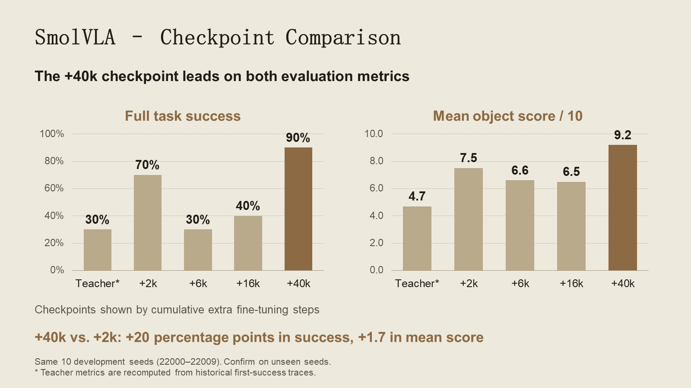

# SmolVLA: paired-scene evaluation on the A3 2×5 task

The +40k checkpoint performed best on these ten development scenes. It succeeded in nine episodes and obtained a mean object score of 9.2 out of 10. This report records the completed experiment as verified on 2026-11-03, including failures and the provenance of the teacher baseline.

## Results

All five models use the same ten scene seeds, 22000–22009. A successful episode must satisfy the complete task criterion, not just reach an object count of ten.

| Checkpoint | Successful episodes | Success rate | Mean object score / 10 |
| --- | ---: | ---: | ---: |
| Teacher baseline, historical trace reconstruction | 3/10 | 30% | 4.7 |
| Fine-tuned +2k | 7/10 | 70% | 7.5 |
| Fine-tuned +6k | 3/10 | 30% | 6.6 |
| Fine-tuned +16k | 4/10 | 40% | 6.5 |
| Fine-tuned +40k | 9/10 | 90% | 9.2 |



The +40k checkpoint improves on +2k by 20 percentage points in success rate and 1.7 points in mean score. Its only failed episode is seed 22003, with a final score of 2/10. Performance is non-monotonic across the staged fine-tuning checkpoints, so training loss or update count alone cannot select the best policy. These ten scenes have been used for development and checkpoint comparison, and a separate unseen-seed evaluation is still needed.

The CSV files retain every model–seed pair. See [summary.csv](data/summary.csv), [episodes.csv](data/episodes.csv), and [comparison_by_seed.csv](data/comparison_by_seed.csv). The 50 rows represent five models on ten shared scenes, not 50 independent test scenes. `mean_success_steps` averages only successful episodes, whose membership differs across models, so it should not be used as a direct overall speed ranking.

## Evaluation protocol

The evaluation measures closed-loop interaction with MuJoCo. The simulator randomizes the scene for each seed, and the policy repeatedly receives camera images, joint state, and the fixed task instruction `transfer 10 cookies into target box`.

| Parameter | Value |
| --- | --- |
| Task | 2×5 target box, 10 cookies |
| Scene randomization | `basic`, boxes and cookies randomized, source column 1 |
| Scene seeds | 22000–22009 |
| Inference seed | 1000, reset for each episode |
| Action execution horizon | 50 |
| Flow integration steps | 25 |
| Maximum control steps | 1000 |
| Release requirement | Enabled (`--require-released`) |
| Episode ending | Stop at full success, safety termination, or the step limit |
| Recording | Three camera views and diagnostic traces during the episode |
| Post-success recording | Disabled |

The release requirement checks that counted cookies are near the box floor and free of left-finger contact. Full success additionally includes the exact-slot arrangement, the expected source-cookie count, and stability for five consecutive control steps. It does not require the arm to withdraw by a specified distance. For example, +6k scored 10/10 on seed 22009 but failed the complete task criterion.

The experiment used Python 3.12.16, PyTorch 2.10.0+cu128, LeRobot 0.5.1, MuJoCo 3.17.0, PyOpenGL 3.1.10, and an NVIDIA A800 80 GB GPU. The evaluation records contain the complete recorded package list, simulator configuration, model identity, and simulator Git revision `0729068ee1e75a562cfbc4f2c83ab9539cf75081`. This evaluated simulator revision should not be assumed to match every later change in this project repository.

## Teacher baseline: why the old final-state score is different

The teacher baseline is reconstructed from an earlier complete run, rather than newly simulated with early stopping. That run used the same success judge but continued policy actions after success until step 1000. Some episodes achieved success and subsequently disturbed the cookies, yielding an original final-state success rate of 0% and mean score of 3.8. Those final-state values are not directly comparable to the new stop-on-success runs.

The reconstruction takes the first full-success state in each historical trajectory, or its final state if it never succeeds. The three successes occurred at seeds 22001, 22002, and 22006, at steps 422, 433, and 426 respectively. This produces the reported 30% success rate and 4.7 mean score. Teacher wall-clock time at the first success cannot be recovered accurately from the total episode time, so that field is blank, not zero.

The provenance remains explicit in every result table. Teacher rows use `historical_trace_first_success`, while the fine-tuned models use `direct_stop_on_success`. [The provenance record](provenance/teacher_baseline.json) records the reconstruction and its checks. [The unmodified historical scores](records/teacher/historical_final_result.json) are included as source evidence with local paths normalized. The large step-by-step trajectories remain on the experiment server, so this repository permits checking the documented reconstruction inputs but does not independently replay the full trajectory scan.

## Training lineage

The models all descend from the instructor-provided A3 checkpoint. The starting checkpoint is [Eter0109/a3-cookie-multi-left8-40k-v1](https://huggingface.co/Eter0109/a3-cookie-multi-left8-40k-v1), revision `ffa4dfbc3e36796a4b02bcf07e6776f6077e49b8`. Demonstrations come from [Eter0109/a3-front-close-left-100](https://huggingface.co/datasets/Eter0109/a3-front-close-left-100), revision `8fdd8a7caf8275eba8be8a83b53a99176a084062`: 100 episodes and 42,681 frames.

The labels denote cumulative additional updates relative to that checkpoint. The stages add 2k, 4k, 10k, and 24k updates to reach +2k, +6k, +16k, and +40k. Each continuation loads the preceding weights but starts a new optimizer and learning-rate schedule. Thus +40k is not a single uninterrupted 40k-step run and does not mean training from scratch.

Training uses supervised offline imitation on the same demonstration set. Batch size is 4, the learning rate warms up over 100 steps to `1e-5` and decays to `1e-6` over each stage. The VLM backbone is frozen, while the action expert and related projections are updated, with about 100 million trainable parameters and no LoRA adapters. The [training records](training/) preserve the settings and completion manifests that were available on the server.

## Representative videos

The examples include both success and failure, while the tables retain all episodes. These front-camera MP4 files are original simulator recordings with no added success tail or editing.

| Video | Result | Purpose |
| --- | --- | --- |
| [+40k, seed 22000](videos/ft40000_seed_22000_front.mp4) | SUCCESS, 10/10, 427 steps | Successful +40k example |
| [+2k, seed 22000](videos/ft2000_seed_22000_front.mp4) | SUCCESS, 10/10, 429 steps | Same-scene checkpoint comparison |
| [+40k, seed 22003](videos/ft40000_seed_22003_front.mp4) | FAIL, 2/10, 1000 steps | The remaining +40k failure |

The full video collection and detailed contact trajectories remain on the experiment server. This upload includes only the three representative videos above, no model weights, and no demonstration dataset.

## Check the published numbers

The verification script runs without GPU or third-party packages. It checks all 50 CSV rows against the 40 fine-tuned episode records and the documented teacher reconstruction, and recalculates the success rates, mean scores, and successful-episode step averages.

```bash
python results/smolvla_2x5_2026-11-03/verify_results.py
```

The saved evaluator can repeat simulations when a compatible environment and a complete local checkpoint bundle are available. Use the recorded simulator revision and dependencies, including the checkpoint's pre/postprocessors and tokenizer, with all local paths resolved for the machine. `A3_ROOT` in archived JSON is a path placeholder, not a configured environment variable. Weights are not distributed in this repository, so the CSV verification is self-contained but a fresh model rollout is not.

```bash
# Run from this project's root in the configured simulation environment.
EXPERIMENT="$PWD/results/smolvla_2x5_2026-11-03"
CHECKPOINT="/absolute/path/to/pretrained_model"
OUT="/absolute/path/to/a/new/evaluation_directory"

export MUJOCO_GL=egl
export PYOPENGL_PLATFORM=egl

python "$EXPERIMENT/evaluator/evaluate_teacher.py" \
  --model smolvla --checkpoint "$CHECKPOINT" --device cuda \
  --profile basic --horizon 50 --flow-steps 25 --inference-seed 1000 \
  --episodes 10 --seed-start 22000 --max-steps 1000 \
  --require-released --diagnostic --out "$OUT"

python "$EXPERIMENT/evaluator/summarize_results.py" "$OUT/result.json"
```

The published JSON records preserve experimental values while normalizing project-root paths to `A3_ROOT`. The source experiment identifiers are `smol_2k_6k_16k_stop_3gSe4D` and `smol_40k_stop_3lEuwt`. The chart figure is the matching presentation chart exported to PNG, and the CSV files are the authoritative numeric source.
